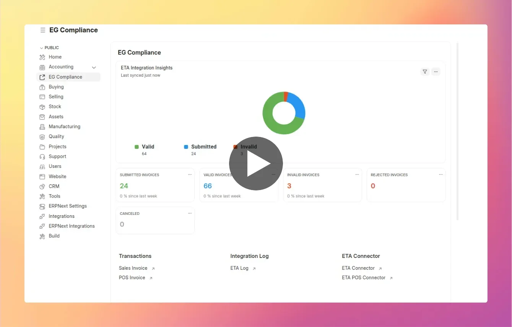
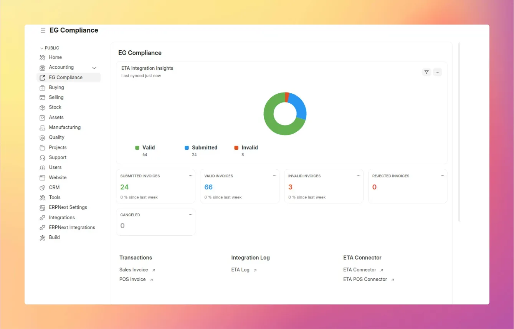
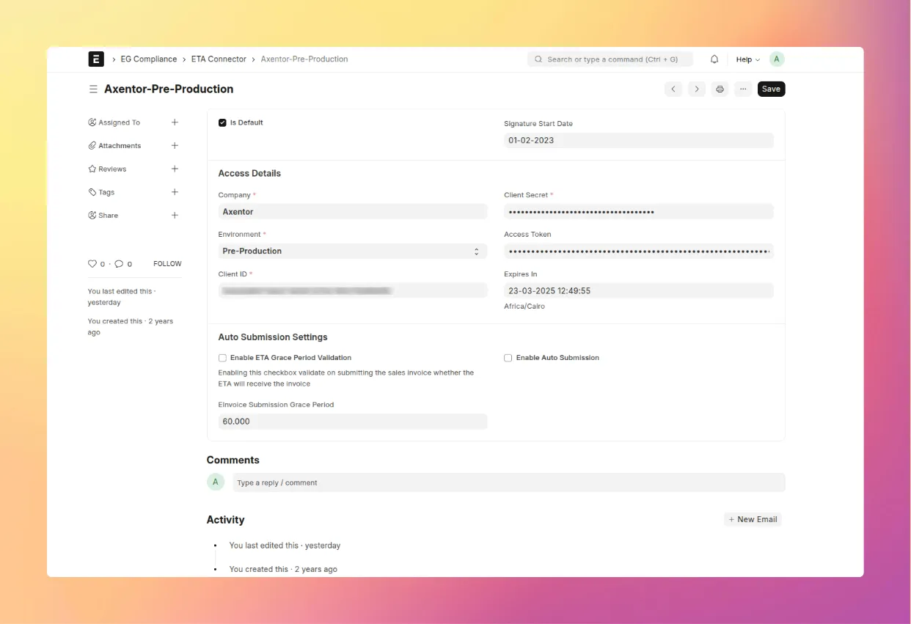
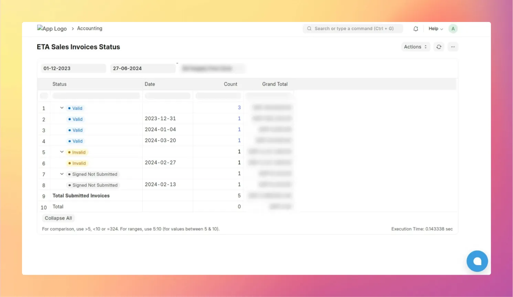
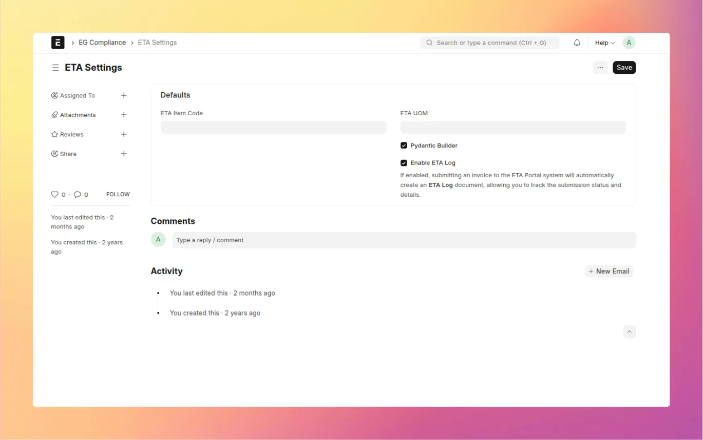
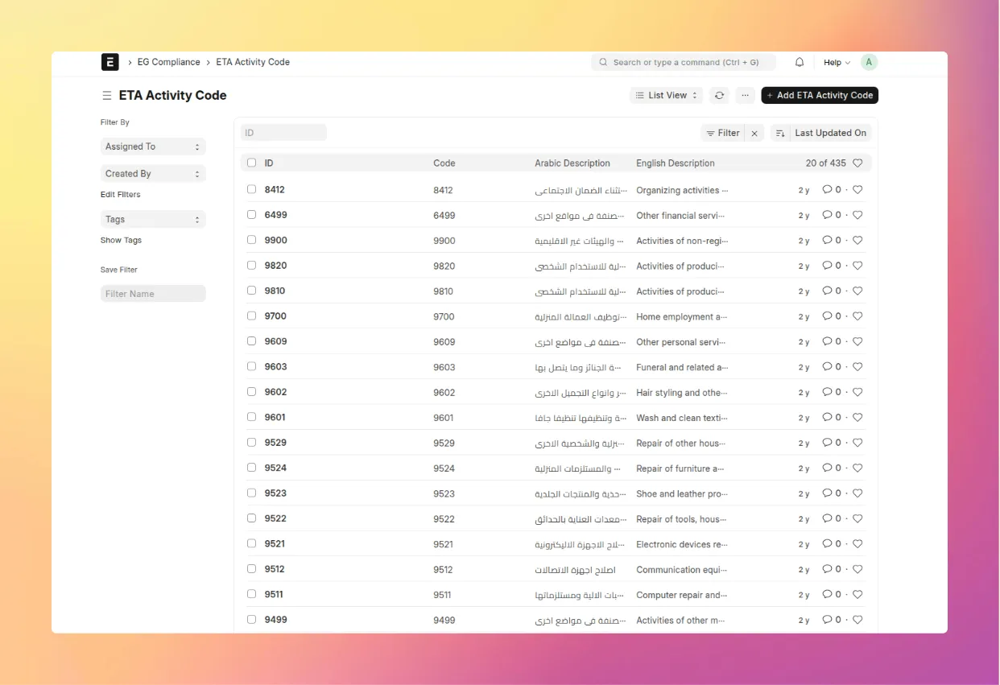

<div align="center">

<h1>Egypt Compliance</h1>

ETA e-invoicing and e-receipts for ERPNext

[](license.txt)

<br><br>
<a href="https://www.youtube.com/watch?v=0CcJNd8YT1w">
  
</a>

</div>

<div align="center">

[Marketplace](https://cloud.frappe.io/marketplace/apps/erpnext_egypt_compliance)
  &nbsp;|&nbsp;
[Docs](https://axe-docs.frappe.cloud/EG%20Compliance/Introduction)
  &nbsp;|&nbsp;
[Demo](https://www.youtube.com/watch?v=0CcJNd8YT1w)

</div>

## Introduction

Egypt Compliance makes Egyptian Tax Authority (ETA) compliance simple from inside ERPNext. Sales Invoices and POS Invoices are validated, signed and sent to ETA, and their ETA status comes back to ERPNext automatically.

It builds on top of [ERPNext](https://github.com/frappe/erpnext) and the [Frappe Framework](https://github.com/frappe/frappe).

## Key Features

### E-Invoicing

Validate, sign and submit Sales Invoices to ETA, one at a time or in hourly batches. Then track their status, cancel them and download the official ETA PDF.

### E-Receipts

Send POS Invoices to the ETA e-receipt system, with one connector per POS Profile.

### Other Features

- **ERPNext ETA Signer**
  Sign invoices on Windows with your ETA signing certificate ([download](https://github.com/Axentorllc/erpnext_egypt_compliance/releases/download/v1.5/ERPNext.ETA.Signer.-.By.Axentor.-.v1.5.zip))

- **ETA Master Data**
  Tax types, units and activity codes included; item codes can be inherited from Item Group or Brand

- **Monitoring**
  EG Compliance dashboard, status report and a log of every submission

<details>
<summary>Screenshots</summary>

**EG Compliance Workspace**


**ETA Connector**


**ETA Log**


**ETA Sales Invoices Status Report**


**ETA Settings**


**ETA Activity Codes**


</details>

## Quick Start

### Installation

Install from the [Frappe Cloud Marketplace](https://cloud.frappe.io/marketplace/apps/erpnext_egypt_compliance), or with bench. Use branch `main` for ERPNext v15 and `version-16` for v16:

```bash
bench get-app https://github.com/Axentorllc/erpnext_egypt_compliance --branch main
bench --site your-site install-app erpnext_egypt_compliance
```

For setup, please [refer to the documentation](https://axe-docs.frappe.cloud/EG%20Compliance/Introduction).

### ETA Access

You need your company registered on the ETA portal, with a client ID and secret for ERPNext, and an ETA signing certificate for the signer.

## Supported Versions

| Frappe / ERPNext | Branch | Release tags |
|---|---|---|
| v15 | `main` | `v15.x.y` |
| v16 | `version-16` | `v16.x.y` |

## Contributing

- [Issue Guidelines](https://github.com/frappe/erpnext/wiki/Issue-Guidelines)
- [Pull Request Requirements](https://github.com/frappe/erpnext/wiki/Contribution-Guidelines)

## License

This project is licensed under [GNU General Public License (v3)](license.txt)

<br />
<div align="center">
  <a href="https://axentor.co" target="_blank">
    
  </a>
  <br />
  Good People, Good Business
</div>
